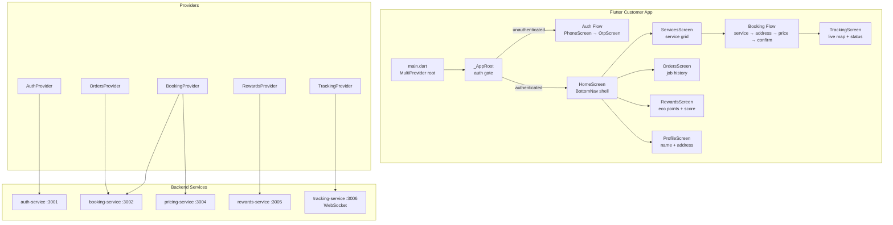
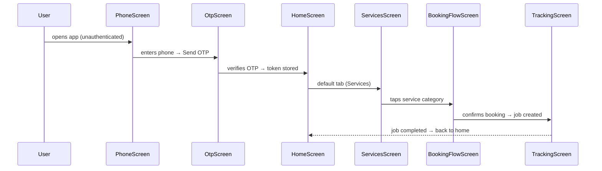
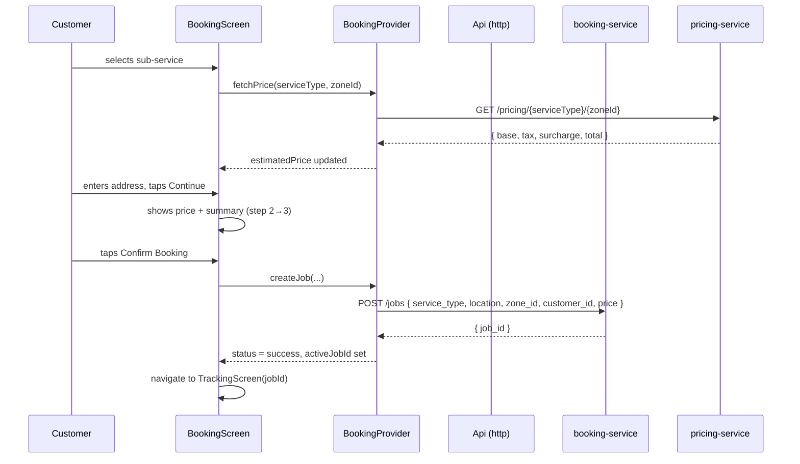
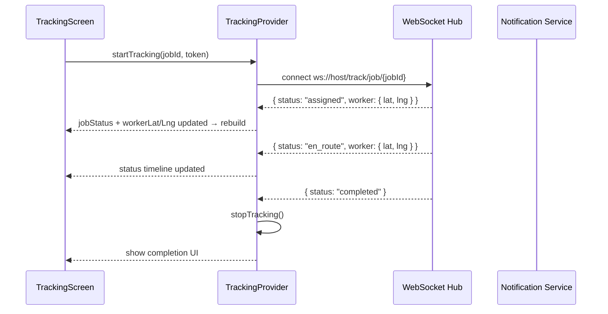

# Design Document: Customer Flutter App (10-Min App)

## Overview

The Ecomins Customer Flutter App is the primary mobile interface through which customers discover, book, and track on-demand home services — cleaning, waste management, logistics, B2B, and recycling. The "10-min" promise means a verified worker is assigned within 10 minutes of booking confirmation. The app consolidates two existing partial implementations (`flutter/ecomins_customer/` and `flutter/customer_app/`) into a single, production-ready Flutter application with clean architecture, robust state management, real-time job tracking, and a rewards system.

The app communicates exclusively with the existing Node.js backend microservices through their REST APIs (auth-service :3001, booking-service :3002, pricing-service :3004, rewards-service :3005, tracking-service :3006) and a WebSocket hub for live location updates. State is managed via the Provider pattern already established in both existing apps, extended with dedicated providers per feature domain.

---

## Architecture

### High-Level App Architecture



### Navigation Flow



### Folder Structure

```
flutter/ecomins_customer/lib/
├── core/
│   ├── api.dart              # HTTP + WebSocket client
│   ├── theme.dart            # AppTheme (Material 3, green palette)
│   └── constants.dart        # base URLs, zone IDs, timeouts
├── features/
│   ├── auth/
│   │   ├── auth_provider.dart
│   │   ├── phone_screen.dart
│   │   └── otp_screen.dart
│   ├── home/
│   │   └── home_screen.dart  # BottomNavigationBar shell
│   ├── services/
│   │   └── services_screen.dart  # service category grid
│   ├── booking/
│   │   ├── booking_provider.dart
│   │   ├── booking_screen.dart   # 3-step Stepper
│   │   └── booking_success_dialog.dart
│   ├── tracking/
│   │   ├── tracking_provider.dart
│   │   └── tracking_screen.dart  # live map + status timeline
│   ├── orders/
│   │   ├── orders_provider.dart
│   │   └── orders_screen.dart
│   ├── rewards/
│   │   ├── rewards_provider.dart
│   │   └── rewards_screen.dart
│   └── profile/
│       └── profile_screen.dart
└── main.dart
```

---

## Components and Interfaces

### AuthProvider

Manages authentication state, token persistence, and OTP flow. Already implemented in `ecomins_customer`; extended with profile fields.

```dart
class AuthProvider extends ChangeNotifier {
  String? token;
  String? phone;
  String? customerName;
  String? customerAddress;
  bool isLoading;
  bool get isLoggedIn;
  bool get hasProfile; // name + address set

  Future<void> requestOtp(String phone);
  Future<void> verifyOtp(String phone, String otp);
  Future<void> saveProfile(String name, String address);
  Future<void> logout();
}
```

### BookingProvider

Orchestrates the multi-step booking flow: service selection → address → price fetch → job creation.

```dart
class BookingProvider extends ChangeNotifier {
  String? selectedServiceId;
  String? selectedSubService;
  String address;
  double? estimatedPrice;
  BookingStatus status; // idle | fetchingPrice | creating | success | error
  String? activeJobId;
  String? errorMessage;

  Future<void> fetchPrice(String serviceType, String zoneId);
  Future<void> createJob({
    required String token,
    required String customerId,
    required String serviceType,
    required String address,
    required String zoneId,
    required double price,
  });
  void reset();
}
```

### TrackingProvider

Subscribes to the WebSocket tracking hub for a given job and exposes live worker location and job status updates.

```dart
class TrackingProvider extends ChangeNotifier {
  String? jobId;
  JobStatus? jobStatus;
  double? workerLat;
  double? workerLng;
  List<StatusEvent> statusHistory;
  bool isConnected;

  void startTracking(String jobId, String token);
  void stopTracking();
  void dispose();
}
```

### OrdersProvider

Fetches and caches the customer's job history.

```dart
class OrdersProvider extends ChangeNotifier {
  List<Job> jobs;
  bool isLoading;
  String? errorMessage;

  Future<void> loadJobs(String token, String customerId);
  Future<void> refresh(String token, String customerId);
}
```

### RewardsProvider

Fetches eco points balance and eco score; handles redemption.

```dart
class RewardsProvider extends ChangeNotifier {
  int pointsBalance;
  int ecoScore;
  bool isLoading;
  String? errorMessage;

  Future<void> loadRewards(String token, String customerId);
  Future<void> redeemPoints(String token, String customerId, int points);
}
```

---

## Data Models

### Job (mirrors backend `Job` type)

```dart
class Job {
  final String id;
  final String customerId;
  final String? workerId;
  final String serviceType;
  final JobStatus status;
  final JobLocation location;
  final String zoneId;
  final double price;
  final String? beforePhotoUrl;
  final String? afterPhotoUrl;
  final DateTime createdAt;
  final DateTime updatedAt;

  factory Job.fromJson(Map<String, dynamic> json);
}

enum JobStatus {
  pending,
  assigned,
  enRoute,
  inProgress,
  completed,
  cancelled;

  static JobStatus fromString(String s);
}
```

### ServiceCategory

```dart
class ServiceCategory {
  final String id;           // e.g. 'cleaning'
  final String label;        // e.g. 'Cleaning'
  final IconData icon;
  final Color color;
  final List<String> subServices;
}
```

### PricingResult

```dart
class PricingResult {
  final double base;
  final double tax;
  final double surcharge;
  final double total;

  factory PricingResult.fromJson(Map<String, dynamic> json);
}
```

### RewardsAccount

```dart
class RewardsAccount {
  final int pointsBalance;
  final int ecoScore;

  factory RewardsAccount.fromJson(Map<String, dynamic> json);
}
```

### StatusEvent (for tracking timeline)

```dart
class StatusEvent {
  final JobStatus status;
  final DateTime timestamp;
  final String label;
}
```

---

## Sequence Diagrams

### Booking Flow



### Live Tracking Flow



---

## Key Functions with Formal Specifications

### BookingProvider.fetchPrice()

```dart
Future<void> fetchPrice(String serviceType, String zoneId)
```

**Preconditions:**
- `serviceType` is non-empty string matching a known service category id
- `zoneId` is non-empty string
- Network is reachable

**Postconditions:**
- On success: `estimatedPrice` equals `PricingResult.total` returned by pricing-service
- On failure: `estimatedPrice` defaults to `500.0` (fallback) and `errorMessage` is set
- `status` transitions from `fetchingPrice` back to `idle`

**Loop Invariants:** N/A

---

### BookingProvider.createJob()

```dart
Future<void> createJob({required String token, required String customerId,
  required String serviceType, required String address,
  required String zoneId, required double price})
```

**Preconditions:**
- `token` is a valid non-expired JWT
- `address` is non-empty
- `price` > 0
- `status` is `idle` (no concurrent booking in flight)

**Postconditions:**
- On success: `activeJobId` is set to the returned `job_id`, `status` = `success`
- On failure: `status` = `error`, `errorMessage` describes the failure
- Exactly one Job record is created in booking-service (no duplicates on retry)

---

### TrackingProvider.startTracking()

```dart
void startTracking(String jobId, String token)
```

**Preconditions:**
- `jobId` is a valid UUID of an existing Job
- `token` is a valid JWT
- No existing WebSocket connection is open for this provider instance

**Postconditions:**
- WebSocket connection is established to `/track/job/{jobId}`
- Incoming messages update `workerLat`, `workerLng`, `jobStatus`, and `statusHistory`
- `isConnected` = true

**Loop Invariants:**
- For each incoming message: `statusHistory` grows monotonically (events are only appended, never removed)
- `jobStatus` only advances forward through the valid state machine (pending → assigned → en_route → in_progress → completed)

---

## Algorithmic Pseudocode

### Booking Flow State Machine

```pascal
ALGORITHM executeBookingStep(currentStep, bookingProvider, input)
INPUT: currentStep (0=selectService, 1=addressAndPrice, 2=confirm)
OUTPUT: nextStep or error

BEGIN
  IF currentStep = 0 THEN
    IF input.selectedSubService = null THEN
      RETURN Error("Select a service")
    END IF
    CALL bookingProvider.fetchPrice(input.serviceType, input.zoneId)
    RETURN nextStep ← 1

  ELSE IF currentStep = 1 THEN
    IF input.address = "" THEN
      RETURN Error("Enter your address")
    END IF
    RETURN nextStep ← 2

  ELSE IF currentStep = 2 THEN
    ASSERT bookingProvider.estimatedPrice > 0
    ASSERT input.address ≠ ""
    CALL bookingProvider.createJob(...)
    IF bookingProvider.status = success THEN
      NAVIGATE to TrackingScreen(bookingProvider.activeJobId)
    ELSE
      DISPLAY bookingProvider.errorMessage
    END IF
  END IF
END
```

**Preconditions:**
- `currentStep` ∈ {0, 1, 2}
- `bookingProvider` is initialized and not in a loading state

**Postconditions:**
- On step 0 success: price is fetched and cached before advancing
- On step 2 success: navigation to TrackingScreen occurs with a valid jobId
- On any error: step does not advance, error is displayed

**Loop Invariants:** N/A (sequential steps, not a loop)

---

### WebSocket Message Handler

```pascal
ALGORITHM handleTrackingMessage(message, trackingProvider)
INPUT: message (JSON from WebSocket)
OUTPUT: updated TrackingProvider state

BEGIN
  event ← parseJson(message)

  IF event.status ≠ null THEN
    newStatus ← JobStatus.fromString(event.status)
    IF isValidTransition(trackingProvider.jobStatus, newStatus) THEN
      trackingProvider.jobStatus ← newStatus
      trackingProvider.statusHistory.append(
        StatusEvent(status: newStatus, timestamp: now())
      )
    END IF
  END IF

  IF event.worker.lat ≠ null AND event.worker.lng ≠ null THEN
    trackingProvider.workerLat ← event.worker.lat
    trackingProvider.workerLng ← event.worker.lng
  END IF

  IF trackingProvider.jobStatus = completed THEN
    CALL trackingProvider.stopTracking()
  END IF

  CALL notifyListeners()
END
```

**Preconditions:**
- `message` is a valid JSON string
- `trackingProvider` has an active WebSocket connection

**Postconditions:**
- `statusHistory` is append-only; no events are removed
- `jobStatus` only moves forward through the valid state machine
- WebSocket is closed when status reaches `completed` or `cancelled`

**Loop Invariants:** N/A (event handler, not a loop)

---

## API Call Signatures

All HTTP calls are centralised in `core/api.dart`. The existing `Api` class is extended:

```dart
class Api {
  // Auth (existing)
  static Future<void> requestOtp(String phone);
  static Future<String> verifyOtp(String phone, String otp);

  // Pricing (existing)
  static Future<PricingResult> getPrice(String serviceType, String zoneId);

  // Jobs (existing + extended)
  static Future<String> createJob({
    required String token,
    required String serviceType,
    required String address,
    required String zoneId,
    required String customerId,
    required double price,
  });
  static Future<List<Job>> getJobs(String token, String customerId);

  // Rewards (existing + typed)
  static Future<RewardsAccount> getRewards(String token, String customerId);
  static Future<void> redeemPoints(String token, String customerId, int points);

  // Tracking (new — WebSocket)
  static WebSocketChannel connectTracking(String jobId, String token);
}
```

Backend port mapping:
| Service | Port | Base path |
|---|---|---|
| auth-service | 3001 | `/auth` |
| booking-service | 3002 | `/jobs` |
| pricing-service | 3004 | `/pricing` |
| rewards-service | 3005 | `/rewards` |
| tracking-service | 3006 | `ws://host/track/job/:id` |

---

## Correctness Properties

A property is a characteristic or behavior that should hold true across all valid executions of the system.

### Property 1: Price displayed equals price stored on job

*For any* booking where the customer sees an estimated price and confirms, the `price` field on the created Job record must equal the `total` returned by the pricing-service for that service type and zone.

**Validates: Requirements 3.5, 13.2**

---

### Property 2: Booking step advancement requires valid input

*For any* step in the booking flow, advancing to the next step must be blocked if the required input for the current step is missing or invalid. No partial or invalid booking state should reach the confirmation step.

**Validates: Requirements 3.1, 3.4**

---

### Property 3: Job creation is idempotent on retry

*For any* network failure during `createJob`, retrying the same request must not create duplicate Job records. The provider must guard against concurrent submissions.

**Validates: Requirements 3.6, 3.7**

---

### Property 4: Tracking status history is monotonically growing

*For any* active tracking session, the `statusHistory` list must only grow (append-only). No status event is ever removed or reordered during a session.

**Validates: Requirements 5.3, 5.4**

---

### Property 5: Tracking status only advances forward

*For any* sequence of WebSocket messages received during a tracking session, the `jobStatus` must only transition forward through the valid state machine (pending → assigned → en_route → in_progress → completed). A message with a backward or invalid status must be ignored.

**Validates: Requirements 5.1, 5.4**

---

### Property 6: Eco Points balance never goes negative

*For any* customer, after any sequence of award and redemption operations surfaced in the app, the displayed `pointsBalance` must never be negative. A redemption attempt exceeding the balance must be rejected before the API call is made.

**Validates: Requirements 15.4, 15.5**

---

### Property 7: Session is restored without re-authentication

*For any* customer with a stored token, launching the app must restore the authenticated session and navigate directly to HomeScreen without showing the auth flow.

**Validates: Requirement 1.5**

---

### Property 8: Profile required before first booking

*For any* customer who has not yet set their name and address, attempting to reach the booking confirmation step must be blocked and the profile screen must be shown.

**Validates: Requirement 1.6**

---

## Error Handling

### Network Errors
- All API calls are wrapped in try/catch; failures set `errorMessage` on the relevant provider
- UI shows a `SnackBar` with the error message and a retry option where applicable
- Pricing fetch failure falls back to ₦500.00 default with a visible warning

### Auth Errors
- Invalid OTP → SnackBar "Invalid OTP, please try again"
- Expired OTP → SnackBar "OTP expired, request a new one"
- Locked account → SnackBar with lockout duration from server response

### Booking Errors
- Missing address → inline validation before API call
- Server 400/409 → SnackBar with server error message
- Booking creation timeout (>10s) → SnackBar "Request timed out, please retry"

### Tracking Errors
- WebSocket disconnect → auto-reconnect with 3s delay, up to 5 attempts
- Stale connection (no message >30s) → show "Reconnecting…" indicator
- Job not found → navigate back to Orders with error toast

### Rewards Errors
- Insufficient balance → client-side guard before API call; SnackBar "Insufficient Eco Points"
- Redemption failure → SnackBar with server message, balance not decremented locally

---

## Testing Strategy

### Unit Testing Approach

Test each provider in isolation using mock API responses:
- `AuthProvider`: token persistence, restore on launch, logout clears storage
- `BookingProvider`: step validation, price fetch, job creation, reset
- `TrackingProvider`: WebSocket message parsing, status transition validation, append-only history
- `OrdersProvider`: job list loading, status color mapping
- `RewardsProvider`: points balance guard, redemption flow

### Property-Based Testing Approach

**Property Test Library**: `fast-check` (tested at the Dart model/logic layer via unit tests; property tests for shared logic run at the Node.js service layer)

For Flutter-specific properties, use `flutter_test` with parameterized inputs:

| Property | Test Description |
|---|---|
| P1 | Price consistency: displayed price == job.price for all service/zone combos |
| P2 | Step advancement blocked on invalid input for all step/input combinations |
| P3 | No duplicate jobs on concurrent createJob calls |
| P4 | statusHistory length is non-decreasing across any message sequence |
| P5 | jobStatus never regresses for any sequence of status strings |
| P6 | pointsBalance never negative after any award/redeem sequence |
| P7 | App root shows HomeScreen for any valid stored token |
| P8 | Booking confirm step unreachable without profile for any customer state |

### Widget Testing Approach

- `PhoneScreen`: phone input validation, OTP request trigger
- `OtpScreen`: 6-digit constraint, verify button state
- `ServicesScreen`: all 5 categories rendered, tap navigates to BookingScreen
- `BookingScreen`: stepper step transitions, confirm button disabled while loading
- `TrackingScreen`: status timeline renders correctly for each JobStatus value
- `OrdersScreen`: empty state, list rendering, status chip colors
- `RewardsScreen`: points and eco score display, redeem button guard

### Integration Testing Approach

- Full booking flow: PhoneScreen → OtpScreen → ServicesScreen → BookingScreen → TrackingScreen
- Session restore: cold launch with stored token → HomeScreen (no auth screens)
- Rewards redemption: load balance → attempt over-redemption → verify rejection → successful redemption
