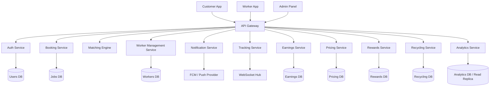
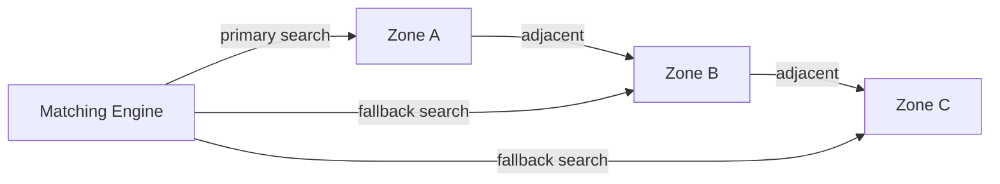

# Design Document: Ecomins Platform

## Overview

Ecomins is a hyperlocal, on-demand sanitation and waste management platform. The system is composed of three client applications (Customer App, Worker App, Admin Panel) backed by a set of microservices exposed through a unified API Gateway. The architecture prioritizes low-latency job matching, real-time tracking, offline resilience for workers, and a scalable zone-based dispatch model.

This document describes the technical architecture, component design, data models, API contracts, correctness properties, error handling strategy, and testing approach for the full platform.

---

## Architecture

The system follows a microservices architecture with a shared API Gateway. Each service owns its data store. Client apps communicate exclusively through the API Gateway. Real-time features (tracking, notifications) use WebSocket connections managed by dedicated services.



### Zone-Based Dispatch Model

Workers and Jobs are assigned to Zones (500m–2km geographic clusters). The Matching Engine operates within zone boundaries first, expanding to adjacent zones only when no local workers are available. This keeps matching latency low and service delivery fast.



---

## Components and Interfaces

### API Gateway

- Single entry point for all client traffic
- Handles authentication token validation (JWT)
- Routes requests to downstream services
- Rate limiting: 100 req/min per authenticated user, 10 req/min for unauthenticated

### Auth Service

Responsibilities:
- OTP generation and delivery via SMS
- OTP validation and session token issuance (JWT, 24h expiry)
- OTP lockout after 3 failed attempts (15-minute lockout)
- OTP expiry after 5 minutes

Interface:
```
POST /auth/request-otp   { phone }
POST /auth/verify-otp    { phone, otp } → { token }
```

### Booking Service

Responsibilities:
- Job lifecycle management (pending → assigned → en_route → in_progress → completed / cancelled)
- Proof image storage (S3-compatible object store)
- B2B contract job generation
- Booking flow validation

Interface:
```
POST /jobs                    { service_type, location, photo_url?, scheduled_time? } → { job_id }
GET  /jobs/:id                → Job
GET  /jobs?customer_id=&status= → [Job]
POST /jobs/:id/start          { before_photo_url }
POST /jobs/:id/complete       { after_photo_url }
POST /jobs/:id/cancel         { reason }
```

### Matching Engine

Responsibilities:
- On Job creation, find nearest available verified Worker with required skill in same Zone
- Expand to adjacent Zones after 2-minute timeout
- Re-match on Worker rejection
- Update Job status and trigger notifications on assignment

Interface (internal, event-driven):
```
Event: job.created       → triggers match attempt
Event: job.rejected      → triggers re-match
Event: worker.unavailable → removes from eligible pool
```

### Worker Management Service

Responsibilities:
- Worker profile CRUD
- KYC document submission and review workflow
- Availability toggle
- Zone assignment

Interface:
```
POST /workers                  { name, phone, zone_id, skills[] }
GET  /workers/:id
PATCH /workers/:id/availability { available: bool }
POST /workers/:id/kyc          { id_document_url, selfie_url }
PATCH /workers/:id/kyc/review  { approved: bool, reason? }
PATCH /workers/:id/zone        { zone_id }
```

### Tracking Service

Responsibilities:
- Receive Worker location updates (from Worker App)
- Broadcast location to subscribed Customers via WebSocket
- Stop broadcasting on Job completion

Interface:
```
WebSocket /track/job/:job_id   (Customer subscribes)
POST /track/location           { worker_id, lat, lng } (Worker pushes)
```

### Notification Service

Responsibilities:
- Send push notifications via FCM (or equivalent)
- Retry failed deliveries up to 3 times with exponential backoff
- Log all notification attempts and outcomes

Interface (internal):
```
POST /notify { user_id, title, body, data? }
```

### Earnings Service

Responsibilities:
- Calculate Worker earnings on Job completion (base rate minus platform commission)
- Store earnings records
- Aggregate daily/weekly/all-time totals

Interface:
```
GET /earnings/:worker_id              → { today, week, all_time }
GET /earnings/:worker_id/jobs         → [EarningsRecord]
```

### Pricing Service

Responsibilities:
- Store base rates, taxes, and zone surcharges per service type
- Compute total price for a booking
- Apply rate updates only to future Jobs

Interface:
```
GET  /pricing/:service_type/:zone_id  → { base, tax, surcharge, total }
POST /pricing                         { service_type, zone_id, base, tax, surcharge }
PATCH /pricing/:id                    { base?, tax?, surcharge? }
```

### Rewards Service

Responsibilities:
- Award Eco Points on eco-service completion
- Track Eco Score per Customer
- Redeem points against bookings

Interface:
```
GET  /rewards/:customer_id            → { points, eco_score }
POST /rewards/:customer_id/award      { points, job_id }
POST /rewards/:customer_id/redeem     { points }
```

### Recycling Service

Responsibilities:
- Record waste weight and category per recycling Job
- Calculate payout (cash or Eco Points)
- Initiate cash transfer for cash-preference customers

Interface:
```
POST /recycling/:job_id/record  { waste_category, weight_kg, payout_preference }
GET  /recycling/:job_id         → RecyclingRecord
```

### Analytics Service

Responsibilities:
- Aggregate Jobs, revenue, waste, and worker metrics
- Support filtering by date range, zone, service type
- CSV export

Interface:
```
GET /analytics/summary?from=&to=&zone_id=&service_type=  → AnalyticsSummary
GET /analytics/export?from=&to=&zone_id=&service_type=   → CSV stream
```

---

## Data Models

### User
```typescript
interface User {
  id: string;           // UUID
  phone: string;        // E.164 format
  name: string;
  role: "customer" | "worker" | "admin";
  created_at: string;   // ISO 8601
}
```

### Worker
```typescript
interface Worker {
  id: string;           // UUID, references User.id
  zone_id: string;
  skills: string[];     // e.g. ["cleaning", "recycling"]
  availability: boolean;
  kyc_status: "pending" | "verified" | "rejected";
  rating: number;       // 0.0 – 5.0
  total_jobs: number;
}
```

### Zone
```typescript
interface Zone {
  id: string;
  name: string;
  center_lat: number;
  center_lng: number;
  radius_meters: number;
  adjacent_zone_ids: string[];
}
```

### Job
```typescript
interface Job {
  id: string;
  customer_id: string;
  worker_id: string | null;
  service_type: string;
  status: "pending" | "assigned" | "en_route" | "in_progress" | "completed" | "cancelled";
  location: { lat: number; lng: number; address: string };
  zone_id: string;
  scheduled_time: string | null;
  before_photo_url: string | null;
  after_photo_url: string | null;
  price: number;
  created_at: string;
  updated_at: string;
}
```

### KYCSubmission
```typescript
interface KYCSubmission {
  id: string;
  worker_id: string;
  id_document_url: string;
  selfie_url: string;
  status: "pending" | "approved" | "rejected";
  reviewed_by: string | null;
  rejection_reason: string | null;
  submitted_at: string;
  reviewed_at: string | null;
}
```

### EarningsRecord
```typescript
interface EarningsRecord {
  id: string;
  worker_id: string;
  job_id: string;
  gross_amount: number;
  commission_rate: number;
  net_amount: number;
  created_at: string;
}
```

### PricingRule
```typescript
interface PricingRule {
  id: string;
  service_type: string;
  zone_id: string;
  base_rate: number;
  tax_rate: number;       // percentage, e.g. 0.18 for 18%
  surcharge: number;
  effective_from: string; // ISO 8601
}
```

### RewardsAccount
```typescript
interface RewardsAccount {
  customer_id: string;
  points_balance: number;
  eco_score: number;
}
```

### RecyclingRecord
```typescript
interface RecyclingRecord {
  id: string;
  job_id: string;
  customer_id: string;
  waste_category: "scrap_metal" | "paper" | "plastic" | "e_waste";
  weight_kg: number;
  payout_amount: number;
  payout_preference: "cash" | "eco_points";
  payout_status: "pending" | "processed";
  created_at: string;
}
```

### B2BContract
```typescript
interface B2BContract {
  id: string;
  client_name: string;
  service_scope: string;
  zone_id: string;
  monthly_rate: number;
  start_date: string;
  end_date: string;
  status: "active" | "expired" | "pending";
  recurrence_schedule: string; // cron expression
}
```

### OTPRecord
```typescript
interface OTPRecord {
  phone: string;
  otp_hash: string;       // bcrypt hash of OTP
  expires_at: string;     // ISO 8601, 5 minutes from creation
  attempts: number;
  locked_until: string | null;
}
```

---

## Correctness Properties

A property is a characteristic or behavior that should hold true across all valid executions of a system — essentially, a formal statement about what the system should do. Properties serve as the bridge between human-readable specifications and machine-verifiable correctness guarantees.

### Property 1: OTP lockout after repeated failures

*For any* phone number, if 3 or more consecutive incorrect OTPs are submitted, the Auth Service should reject all further OTP attempts for that phone until the lockout period expires.

**Validates: Requirements 1.3**

---

### Property 2: OTP expiry invalidation

*For any* OTP that was issued more than 5 minutes ago, submitting it should result in an authentication failure regardless of correctness.

**Validates: Requirements 1.4**

---

### Property 3: Booking flow price consistency

*For any* service type and zone combination, the price displayed to the Customer during booking should equal the price stored on the resulting Job record.

**Validates: Requirements 3.5, 13.2**

---

### Property 4: Matching only assigns verified, available workers

*For any* Job in "pending" status, the Matching Engine should only assign Workers whose `kyc_status` is "verified" and `availability` is true and whose skills include the Job's `service_type`.

**Validates: Requirements 4.1, 7.6**

---

### Property 5: Nearest worker is assigned first

*For any* set of eligible Workers for a Job, the Worker with the smallest geographic distance to the Job location should be assigned.

**Validates: Requirements 4.2**

---

### Property 6: Proof required before status transition

*For any* Job, transitioning to "in_progress" requires a before photo, and transitioning to "completed" requires an after photo. Attempting either transition without the required photo should be rejected.

**Validates: Requirements 6.1, 6.2, 6.4**

---

### Property 7: Earnings net amount invariant

*For any* completed Job, the Worker's net earnings should equal the gross job amount multiplied by (1 - commission_rate), and this value should always be non-negative.

**Validates: Requirements 9.1, 9.5**

---

### Property 8: Pricing rule temporal isolation

*For any* pricing rule update, Jobs created before the update time should retain their original price, and Jobs created after the update time should use the new price.

**Validates: Requirements 13.3**

---

### Property 9: Eco Points balance non-negative invariant

*For any* Customer, after any sequence of award and redemption operations, the Customer's Eco Points balance should never be negative.

**Validates: Requirements 15.4, 15.5**

---

### Property 10: Recycling payout calculation consistency

*For any* recycling Job, the payout amount recorded should equal the waste weight multiplied by the current buy rate for the waste category.

**Validates: Requirements 18.4**

---

### Property 11: Availability toggle immediate effect

*For any* Worker, after toggling availability to "unavailable", the Matching Engine should not assign that Worker to any new Job until availability is toggled back to "available".

**Validates: Requirements 8.5, 8.6**

---

### Property 12: Job status transition validity

*For any* Job, status transitions must follow the valid state machine: pending → assigned → en_route → in_progress → completed, or any state → cancelled. Any other transition should be rejected.

**Validates: Requirements 4.3, 8.3, 5.5**

---

### Property 13: Offline sync idempotency

*For any* set of locally buffered status updates on the Worker App, syncing them to the server once should produce the same result as syncing them multiple times (idempotent sync).

**Validates: Requirements 16.2, 16.3**

---

### Property 14: Analytics filter correctness

*For any* analytics query with a date range filter, all returned Job records should have `created_at` values within the specified range, and no Jobs outside the range should appear.

**Validates: Requirements 12.2**

---

## Error Handling

### Auth Service
- Invalid OTP → 401 with message "Invalid OTP"
- Expired OTP → 401 with message "OTP expired"
- Locked account → 429 with message "Too many attempts, retry after {time}"
- Invalid phone format → 400 with message "Invalid phone number"

### Booking Service
- Invalid image format/size → 400 with descriptive message
- Missing required fields → 400 with field-level validation errors
- Job not found → 404
- Invalid status transition → 409 with current status and allowed transitions

### Matching Engine
- No workers in zone → expand to adjacent zones, then set status "unassigned" with estimated wait
- Worker rejects → immediate re-match, no error surfaced to Customer

### Notification Service
- Delivery failure → retry 3x with exponential backoff (1s, 2s, 4s), then log failure
- Invalid device token → remove token from registry, log event

### Tracking Service
- WebSocket disconnect → client reconnects and re-subscribes; server buffers last known location
- Stale location (>30s old) → mark as "location unavailable" on Customer map

### General
- All services return errors in a consistent envelope:
```json
{
  "error": {
    "code": "ERROR_CODE",
    "message": "Human-readable description",
    "details": {}
  }
}
```
- All 5xx errors are logged with full request context and trigger an alert
- No stack traces are returned to clients in production

---

## Testing Strategy

### Dual Testing Approach

Both unit tests and property-based tests are required. They are complementary:
- Unit tests verify specific examples, edge cases, and integration points
- Property-based tests verify universal correctness across all valid inputs

### Property-Based Testing Library

- **Backend (Node.js/TypeScript)**: `fast-check`
- **Mobile (React Native)**: `fast-check` (shared logic tested at service layer)

Each property-based test must run a minimum of **100 iterations**.

Each test must be tagged with a comment in the format:
```
// Feature: ecomins-platform, Property N: <property_text>
```

### Property Test Mapping

| Property | Test Description | Library |
|---|---|---|
| P1 | OTP lockout after 3 failures | fast-check |
| P2 | OTP expiry invalidation | fast-check |
| P3 | Booking price consistency | fast-check |
| P4 | Matching only assigns eligible workers | fast-check |
| P5 | Nearest worker assigned first | fast-check |
| P6 | Proof required for status transitions | fast-check |
| P7 | Earnings net amount invariant | fast-check |
| P8 | Pricing rule temporal isolation | fast-check |
| P9 | Eco Points non-negative invariant | fast-check |
| P10 | Recycling payout calculation | fast-check |
| P11 | Availability toggle immediate effect | fast-check |
| P12 | Job status transition validity | fast-check |
| P13 | Offline sync idempotency | fast-check |
| P14 | Analytics filter correctness | fast-check |

### Unit Test Focus Areas

- Auth OTP generation and hashing
- Booking flow field validation
- Image upload format/size validation
- KYC workflow state transitions
- Earnings calculation with known inputs
- Pricing rule application with known rates
- Notification retry logic
- B2B contract job generation schedule
- Recycling payout with known weights and rates

### Integration Test Focus Areas

- End-to-end booking flow (Customer → Booking Service → Matching Engine → Worker notification)
- Job completion flow (Worker proof upload → status update → earnings calculation → Customer notification)
- KYC approval flow (Worker submission → Admin review → Worker status update)
- Recycling flow (booking → completion → payout)
